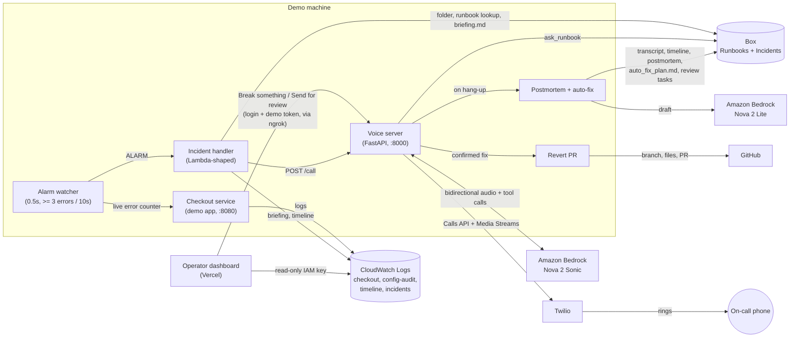

# 🔥 Pilot Light - Voice AI Incident Response Agent | Hackathon 1st Place Winner

**Always on. Ignites when production breaks.**

🏆 **1st Place Winner, Agentic Enterprise AI Hackathon hosted by Amazon Web Services (AWS) and Box**

Built for the Box + AWS Agentic Enterprise AI Hackathon, Seattle, October 16 to 17, 2026.

When production breaks, Pilot Light **phones the on-call engineer**. A voice agent on **Amazon Nova 2 Sonic** briefs them on what broke, answers questions from live AWS data and **Box** runbooks, and runs an approved fix only after the engineer says **"confirm."** Every step is recorded in a **Box incident folder**, a **postmortem** is drafted and assigned for human review, the fix is opened as a **GitHub pull request**, and an **auto-fix plan** for the root cause is waiting in Box when the call ends.

- **Live dashboard:** https://pilot-light-beta.vercel.app (login required)
- **Demo flow:** Break something → phone rings in about 3 seconds → "What changed?" → "Roll it back" → "Confirm" → errors stop → PR, postmortem, and auto-fix plan appear

## The problem

When production breaks at night, the on-call engineer loses precious minutes figuring out what went wrong before they can fix it. Afterward, someone still has to write up what happened, usually from memory.

## How Pilot Light solves it

- **No time lost figuring things out.** Pilot Light calls the engineer and briefs them immediately: what is failing, what changed, how many errors are active, and what the runbook says. No laptop, no dashboards.
- **Safe by design.** It can only run allowlisted fixes, only after a spoken "confirm" that is checked in code, and every action is audited and opened as a pull request for review.
- **The paperwork writes itself.** The transcript, timeline, and postmortem land in Box automatically, with a review task assigned to a human.
- **It helps prevent the next incident.** After the call, Box AI and Amazon Nova analyze the postmortem and draft an auto-fix plan of concrete tasks. One command turns each task into a ready-to-review pull request with Claude Code.

## Architecture



### Incident flow

| Step | What happens | Measured |
|---|---|---|
| 1. Break | The dashboard's **Break something** button (or `scripts/break.sh`) pushes a bad payment configuration. Checkout requests fail with `PaymentError`. | 0s |
| 2. Detect | The watcher reads the checkout service's live error counter every 0.5s and fires at 3 or more errors in 10 seconds. | 1.4s |
| 3. Brief and dial | The incident handler records what changed and the error count, writes the incident and timeline to CloudWatch Logs, and places the call first. The Box folder, runbook lookup, and `briefing.md` upload run while the phone rings. | 3.0s to dial |
| 4. Talk | Nova 2 Sonic speaks the briefing and answers with tools: `what_changed`, `query_logs` (CloudWatch Logs Insights), `ask_runbook` (Box AI). The runbook is preloaded into the prompt while the phone rings. | |
| 5. Fix | "Roll it back", then "Confirm". The code checks the engineer's own words for "confirm" before `rollback_payment_config` runs. | |
| 6. Pull request | A GitHub PR with `config/flags.json` and the incident record opens in the background. | about 5s after confirm |
| 7. Record | On hang-up, Nova 2 Lite drafts the postmortem from the timeline and transcript. Transcript, timeline, and postmortem go to Box with a review task. | about 10s after hang-up |
| 8. Prevent | Auto-fix plan mode: Box AI analyzes the postmortem, transcript, and runbook; Nova 2 Lite extracts tasks; `auto_fix_plan.md` and a review task go to Box. | about 30s after hang-up |

Timings are from a live test call on October 17.

### Why this shape (event account constraints)

The hackathon AWS account restricts services through an organization policy: CloudFormation, Lambda, DynamoDB, SSM, EventBridge, API Gateway, S3 writes, CloudWatch metrics and alarms, and Amazon Connect are blocked. The build therefore uses **CloudWatch Logs as the event store** and runs the checkout service, alarm watcher, and voice server on the demo machine. The incident handler keeps the Lambda signature and an EventBridge-shaped event, and the repo includes the serverless and Amazon Connect production path (`infra/stack.py`, `connect/`, `services/hangup|session|tools/`) for an account where those services are allowed.

## Safety guardrails

- **Allowlist only.** One action can run: `rollback_payment_config`. Anything else is refused out loud.
- **Verbal confirmation enforced in code.** The model's `confirmed` flag only counts if the engineer's latest transcribed turn contains "confirm" (`REQUIRE_SPOKEN_CONFIRM`, on by default).
- **Audit trail.** Every tool call, utterance, and action is written to the CloudWatch Logs timeline and the Box incident folder.
- **Reviewable changes.** Every fix opens a GitHub pull request; auto-fix PRs run in an isolated git worktree, never in the live repository.
- **Human review.** The postmortem and auto-fix plan are drafts with Box review tasks assigned to a person.
- **No duplicate pages.** A repeat alarm within 30 minutes keeps the open incident and does not call twice.
- **Least privilege for the dashboard.** The hosted dashboard uses an IAM user that can only read the `/pilotlight/*` log groups; demo actions require login plus a shared token checked on the demo machine.

## APIs and integrations used

### Amazon Web Services

| Service | API or feature | Used for |
|---|---|---|
| Amazon Bedrock, **Nova 2 Sonic** (`amazon.nova-2-sonic-v1:0`, us-east-1) | `InvokeModelWithBidirectionalStream` (aws-sdk-bedrock-runtime, awscrt transport) | Real-time speech to speech on the phone call, with tool calling |
| Amazon Bedrock, **Nova 2 Lite** (`us.amazon.nova-2-lite-v1:0`, us-east-2) | `Converse` | Postmortem drafting, auto-fix task extraction, runbook answers when Box AI is unavailable, text agent (`pilotlight/chat.py`) |
| Amazon CloudWatch Logs | `CreateLogGroup`, `PutRetentionPolicy`, `CreateLogStream`, `PutLogEvents`, `GetLogEvents`, `FilterLogEvents` | Checkout logs, config audit ("what changed"), incident timeline (one stream per incident), incident records |
| CloudWatch Logs Insights | `StartQuery`, `GetQueryResults` | Error counts by type for `query_logs` |
| CloudWatch Logs Live Tail | console | Live error stream on stage |
| AWS IAM | IAM user with an inline read-only logs policy | Credentials for the hosted dashboard |
| AWS CLI | `aws login` | Short-lived developer credentials |

### Box Platform API

Python SDK `box-sdk-gen` with **Client Credentials Grant** (service account). Base URL `https://api.box.com/2.0`; uploads use `https://upload.box.com/api/2.0`.

| What we use | SDK call | REST endpoint | Where |
|---|---|---|---|
| Auth (CCG) | `BoxCCGAuth` | `POST /oauth2/token` (on api.box.com, not under /2.0) | `box_client.py` |
| Current user check | `users.get_user_me` | `GET /users/me` | `scripts/box_setup.py` |
| Get folder | `folders.get_folder_by_id` | `GET /folders/{id}` | `scripts/box_setup.py` |
| Create incident folder | `folders.create_folder` | `POST /folders` | `box_tools.create_incident_folder` |
| List folder items | `folders.get_folder_items` | `GET /folders/{id}/items` | auto-fix |
| Upload file | `uploads.upload_file` | `POST /files/content` (upload host) | briefing, transcript, timeline, postmortem, plan |
| New file version | `uploads.upload_file_version` | `POST /files/{id}/content` (upload host) | re-uploads, runbook updates |
| Download file | `downloads.download_file` | `GET /files/{id}/content` | runbook text, auto-fix inputs |
| **Box AI Ask** | `ai.create_ai_ask` | `POST /ai/ask` | `ask_runbook` on the call, auto-fix analysis |
| **Metadata query** | `search.search_by_metadata_query` | `POST /metadata_queries/execute_read` | find the runbook for an alarm |
| Get metadata template | `metadata_templates.get_metadata_template` | `GET /metadata_templates/enterprise/{key}/schema` | setup check |
| Create metadata template | `metadata_templates.create_metadata_template` | `POST /metadata_templates/schema` | `scripts/box_setup_metadata.py` |
| Apply metadata to a file | `file_metadata.create_file_metadata_by_id` | `POST /files/{id}/metadata/enterprise/{template}` | runbook metadata |
| Read file metadata | `file_metadata.get_file_metadata_by_id` | `GET /files/{id}/metadata/enterprise/{template}` | setup check |
| List folder collaborators | `folders.get_folder_collaborations` | `GET /folders/{id}/collaborations` | setup check |
| Add collaborator | `user_collaborations.create_collaboration` | `POST /collaborations` | teammates and reviewer access |
| Create review task | `tasks.create_task` | `POST /tasks` | postmortem and auto-fix plan review |
| Assign task | `task_assignments.create_task_assignment` | `POST /task_assignments` | assign to `BOX_REVIEWER_LOGIN` |

Box layout: `/Runbooks` (metadata template `runbook`: `service`, `alarm_name`, `severity`) and `/Incidents/<INC-id>/` with `briefing.md`, `transcript.md`, `timeline.md`, `postmortem.md`, `auto_fix_plan.md`.

### Twilio

| What we use | API | Used for |
|---|---|---|
| Outbound call | Calls API `calls.create` with a TwiML URL | Ringing the on-call phone |
| Call instructions | TwiML `<Connect><Stream>` with a custom `incident_id` parameter, served at `/twiml` | Bridging the call audio to the voice server |
| Media Streams | WebSocket events `start`, `media` (8 kHz mu-law), `mark`, `clear`, `stop` | Two-way audio with Nova 2 Sonic, hang-up after the goodbye plays |
| Hang up | Calls API `calls(sid).update(status="completed")` | Agent ends the call |
| Voice dialing permissions | Voice API `dialing_permissions` | Enabling standard US numbers |

### GitHub

| What we use | API | Used for |
|---|---|---|
| Revert pull request | REST via the `gh` CLI: `GET /repos/{repo}/git/ref/heads/main`, `POST /repos/{repo}/git/refs`, `PUT /repos/{repo}/contents/{path}`, `POST /repos/{repo}/pulls` | A reviewable PR for every confirmed fix |
| Auto-fix PRs | Claude Code CLI (`claude -p`) in a temporary `git worktree` | Turning auto-fix plan tasks into pull requests (opt-in) |

### Hosting, tooling, and libraries

| Item | Used for |
|---|---|
| Vercel (FastAPI zero-config, `index.py`) | Hosting the operator dashboard |
| ngrok (static domain) | Public HTTPS and WSS for the voice server on the demo machine |
| FastAPI, uvicorn, websockets | Voice server and dashboard |
| `box-sdk-gen` | Box Platform API |
| `boto3` | CloudWatch Logs and Bedrock Converse |
| `aws-sdk-bedrock-runtime`, `awscrt` | Nova 2 Sonic bidirectional streaming (boto3 does not support it) |
| `twilio` | Calls API |
| `audioop` (Python 3.12) | mu-law and PCM conversion, resampling, noise gate |
| `python-dotenv` | Local configuration |
| Claude Code | Development, review agents, and the auto-fix PR step |

## Agent tools

Defined in [pilotlight/tools.py](pilotlight/tools.py) and exposed to Nova 2 Sonic. Every tool returns short, speakable text; the incident ID is injected server side.

| Tool | Purpose |
|---|---|
| `get_briefing` | Opening briefing from the incident record |
| `query_logs` | Error count and top error from CloudWatch Logs Insights |
| `what_changed` | The latest configuration change, who made it, and when |
| `ask_runbook` | Box AI answer from the runbook found by metadata, with a Bedrock fallback |
| `execute_remediation` | The allowlisted rollback, gated on a spoken "confirm" |
| `end_call` | Says goodbye and hangs up |

## Operator dashboard

Read-only console at https://pilot-light-beta.vercel.app: live incident view with transcript, timeline, response tracker, a 5-second error chart, live metrics (service health, call state, time to engineer, time to mitigate), the Box record checklist with links, guardrails, incidents list, events feed, and console links. **Break something**, **Reset service**, and **Send for review** act on the demo machine through the voice server.

## Repo layout

```
pilot-light/
  pilotlight/          shared package
    agent.py           text agent, tool specs, confirm gate
    aws_tools.py       query_logs, what_changed, execute_remediation
    box_client.py      Box CCG client
    box_tools.py       folders, uploads, runbook lookup, Box AI, review tasks
    config.py          settings
    flags.py           the payment configuration switch and its audit trail
    incidents.py       incident records and dedupe
    logstore.py        CloudWatch Logs helpers
    postmortem.py      postmortem drafting and Box uploads
    revert_pr.py       GitHub PR for every confirmed fix
    timeline.py        incident timeline in CloudWatch Logs
    auto_fix/          plan mode and PR mode
    connect.py         Amazon Connect production path
  voice/               Twilio Media Streams bridge, Nova 2 Sonic session, prompt, audio
  services/
    checkout/          demo checkout service with a live error counter
    incident/          alarm watcher and incident handler
    hangup|session|tools/  Amazon Connect production handlers
  dashboard/           operator dashboard (FastAPI + static UI)
  index.py             Vercel entry point
  scripts/             setup, start, traffic, break, fix, status, Box setup, test call
  runbooks/            runbook uploaded to Box
  infra/stack.py       serverless production path (CDK)
  connect/             Amazon Connect setup and agent prompt
  samples/             example transcript, timeline, postmortem
```

## Setup

**Prerequisites:** Python 3.12 (3.13 removes `audioop`), AWS CLI with Bedrock access to Nova 2 Sonic (us-east-1) and Nova 2 Lite, a Box app with Client Credentials Grant authorized by an admin, a Twilio account with a voice number, an ngrok static domain, and the `gh` CLI logged in for pull requests.

```bash
git clone https://github.com/kneha07/Pilot-Light.git && cd Pilot-Light
python3.12 -m venv .venv && source .venv/bin/activate
pip install -r requirements.txt
cp .env.example .env                    # fill in values; never commit .env
aws login --profile pilotlight
python scripts/setup_aws.py             # CloudWatch Logs groups
python scripts/box_setup.py             # verify Box, upload runbook and metadata
```

## Running the demo

```bash
.venv/bin/uvicorn voice.server:app --port 8000                  # voice server
ngrok http 8000 --url https://<your-static-domain>              # public address
scripts/start.sh                                                 # checkout service + alarm watcher
scripts/traffic.sh                                               # steady traffic
```

Then click **Break something** on the dashboard, or run `scripts/break.sh`. Useful extras: `scripts/status.sh` (latest incident timeline), `scripts/fix.sh` (manual reset), `python -m pilotlight.chat` (text agent), `python -m pilotlight.auto_fix <INCIDENT_ID> --pr` (auto-fix pull requests).

## Team

Zain Bhutta, Neha Kumari, Harika Satti, Rajanikant Tenguria

## Acknowledgments

Thank you to AWS, Box, AI House, and Major League Hacking for hosting and sponsoring the event.

## License

Copyright (c) 2026 Zain Bhutta, Neha Kumari, Harika Satti, Rajanikant Tenguria. All rights reserved. No permission is granted to use, copy, fork, modify, or distribute this code without written permission. See [LICENSE](LICENSE).
